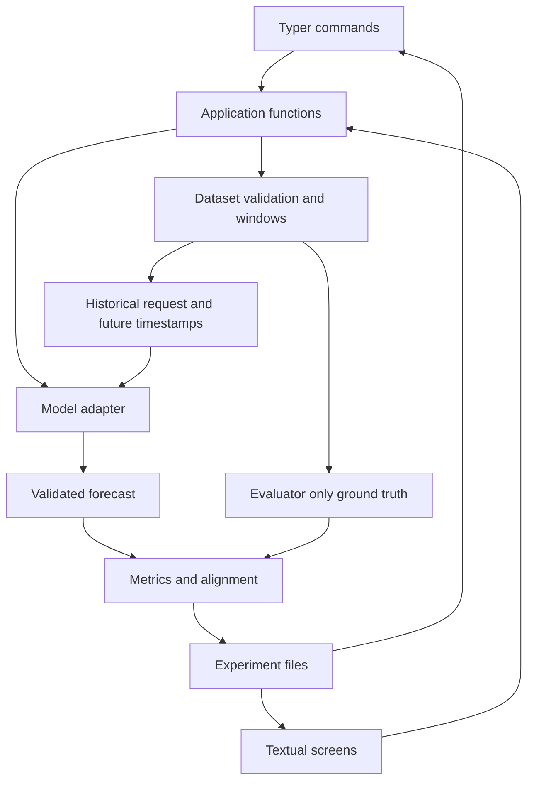

# TSFM Lab architecture proposal

Status: initial direction agreed on 25 October 2026. The numerical core is
implemented along with shell commands and local records. Interactive terminal
and pretrained-model sections describe later work.

TSFM Lab should make a local forecasting evaluation reproducible from dataset
selection through exported predictions. The first engineering goal is a verified
numerical experiment. The first product release adds a scriptable command line,
one pretrained model adapter, experiment history, and an interactive terminal.

## Critique of the product brief

The brief correctly separates models, data, evaluation, domains, and presentation.
Its principal risk is implementing all of these as extensible frameworks before
one forecast can be evaluated correctly. Use these narrower choices:

| Issue | Proposed response |
| --- | --- |
| The proposed directory tree has many layers without current behavior. | Start with contracts, data, models, evaluation, and tests; add other modules when they have a caller. |
| A family name could imply capabilities that vary across versions. | Represent family, adapter implementation, and checkpoint separately. Give Chronos-Bolt and Chronos-2 different adapter IDs. |
| A single generic forecast array hides alignment and point-estimate semantics. | Include request identity, origin, target timestamps, and the point statistic. Validate every output before scoring. |
| Panels, multiple targets, covariates, and probability distributions multiply the first contract. | Implement one regular univariate series and point forecasts first. Reject unimplemented features explicitly. |
| A database, forecast cache, and worker orchestration can dominate early work. | Begin with synchronous inference and run directories. Add one worker process with the TUI; defer a database index and automatic inference reuse. |
| The brief lists training among later possibilities despite excluding it from the product. | Keep training, fine-tuning, optimization, and distributed compute outside this roadmap. |
| A terminal application alone is not evidence of a novel evaluator. | Position the product around its local terminal workflow and inspect existing evaluation libraries before expanding the numerical engine. |

[fev](https://github.com/autogluon/fev) already provides extensible forecasting
tasks, rolling windows, and evaluation summaries.
[GluonTS](https://ts.gluon.ai/stable/) provides forecasting data, models, and
evaluation components. TSFM Lab should not claim novelty for these primitives.
The proposed small baseline core makes the first temporal contract inspectable;
before adding panel or probabilistic evaluation, compare reuse of fev with
maintaining those features locally. Neither library is an initial dependency.

## Bounded first product release

The release accepts local CSV and Parquet files containing one timestamp column
and one numeric target, with a declared regular frequency and target units.
It runs last-value, seasonal-naive, or Chronos-Bolt forecasts on identical rolling
origins. Users can inspect and export predictions and point metrics, reload
experiment records, and compare compatible completed runs.

The terminal supports a guided experiment flow and equivalent YAML-driven shell
commands. Interactive progress and cancellation are required before calling the
terminal product complete. Simple tables and a short forecast preview are enough;
advanced charts and resource telemetry can follow.

Panels, multivariate targets, covariates, probabilistic scoring, a second model
family, finance, plugins, model environment orchestration, a web service, and
automatic result caching are deferred. One configured horizon per experiment is
sufficient; lead-time metrics cover steps 1 through that horizon. Separate runs
can evaluate different horizons.

## Proposed technology stack

| Concern | Choice and boundary |
| --- | --- |
| Python | Numerical core requires Python 3.11+. CI is configured for 3.11, 3.12, and 3.13 on Linux/macOS; local checks use 3.13. Model-runtime compatibility needs separate validation. |
| Numerical core | NumPy arrays; pandas for file ingestion, timestamp parsing, and frequency validation. No torch dependency in the core. |
| Internal contracts | Typed dataclasses and explicit validation. Avoid a schema framework for the first numerical slice. |
| Packaging | `src/tsfm_lab`, `pyproject.toml`, setuptools build backend. Start with standard virtual environments and pip; do not require a new package manager. |
| Quality checks | pytest, Ruff for linting, Black for formatting. Add a package build check with packaging; type checking follows meaningful typed interfaces. |
| Shell interface | Typer for commands and Rich for human-readable tables and progress. JSON output remains free of formatting. |
| Interactive interface | Textual, introduced after the shell workflow works. Keep its imports outside the numerical core. |
| Configuration | YAML using safe parsing, an explicit schema version, unknown-field rejection, and conversion to the same validated internal objects used by Python callers. |
| Files | JSON for manifests and metrics; CSV initially, then Parquet for predictions through a separately declared PyArrow dependency. |
| Pretrained models | Optional `huggingface_hub`, `chronos-forecasting`, and compatible PyTorch/runtime dependencies behind a Chronos extra. Select and test exact versions during adapter implementation. |

[Typer](https://typer.tiangolo.com/) supplies typed command construction.
[Textual](https://textual.textualize.io/guide/testing/) supplies headless interaction
tests. Their roles fit a shell interface and a stateful terminal application
respectively; neither belongs in forecasting or scoring functions.

Declaring proposed dependencies does not authorize installing them. Introduce
dependencies at their milestone, validate supported combinations, and record
resolved versions in experiment records. A reproducible development environment
file should accompany packaging after dependency selection is agreed.

## Component boundaries



Application functions coordinate validation, loading, execution, and persistence.
They return ordinary Python values and emit progress events through an optional
callback. They do not print, prompt, import terminal frameworks, or embed trading
logic. The initial entry point can be one `run_experiment` function, without a
service container, event bus, or generic repository hierarchy.

An adapter receives only the historical request and inference options. It never
receives an evaluation window object containing future observations. Data loaders
do not choose metrics, and metrics do not load models. Future domain extensions
consume validated predictions and their metadata through ordinary Python calls.

## Terminal execution and cancellation

First run the numerical core synchronously. Add `tsfm run`, `models list`,
`datasets inspect`, `experiments list/show`, `compare`, and `export` as the shell
workflow matures. These are proposed command names, not current commands.

Before the TUI is implemented, `tsfm` without arguments shows help. At the TUI
milestone it launches the application only on an interactive terminal; redirected
input/output must never launch a full-screen interface or ask an unexpected
question. Use stdout for results, stderr for progress and errors, and `--json`
for structured outputs. Proposed exit codes are 0 for success, 2 for invalid
configuration, 1 for execution failure, and 130 for user cancellation.

The TUI launches one local inference process using a spawn-compatible entry
point. A queue carries small progress/status events, while result files carry
large arrays. The worker loads the model inside its process. Both terminal modes
call the same orchestration code; the synchronous path remains useful for tests.

Cancellation is cooperative between batches. The UI must distinguish a requested
stop from a worker that has actually stopped. Allow process termination after a
documented grace period and retain a cancelled/incomplete record. No background
job server or resumable execution is required.
[Textual workers](https://textual.textualize.io/guide/workers/) keep application
work separate from rendering, but thread cancellation alone does not guarantee
that native inference has stopped. A worker process also avoids sharing a loaded
model with the UI process.

## Local persistence

Use a user-selected workspace with `experiments/<uuid>/`. JSON run manifests are
the source of truth. A small installation can list history by scanning these
manifests; add a rebuildable SQLite index only after directory scanning becomes
inadequate. This deliberately simplifies the SQLite-first suggestion in the
brief and is part of the owner review decision.

Each run directory contains a validated configuration snapshot, provenance and
status manifest, metrics, and predictions. Write temporary files in the same
directory, then atomically replace their destination. Mark a run completed only
after artifacts are readable and their checksums have been recorded. Multiple
run directories do not share a writer. A crashed run remains incomplete and must
never appear as a completed comparison candidate.

Preserve failed/cancelled runs and identify the stage and error without recording
credentials or private access tokens. Full resume is deferred. Persisted
predictions can be rescored explicitly without rerunning inference; automatic
forecast cache lookup is deferred until identity and invalidation are tested.

Use Hugging Face's version-aware cache for downloaded models, independently of
experiment storage. Do not copy weights into every run directory or implement
a second checkpoint cache.

## Hugging Face integration and first checkpoint

Propose `chronos-bolt` as the first pretrained adapter and
[`amazon/chronos-bolt-tiny`](https://huggingface.co/amazon/chronos-bolt-tiny) as its
CPU integration checkpoint. The official model card lists Apache-2.0 and
Safetensors. [`amazon/chronos-bolt-small`](https://huggingface.co/amazon/chronos-bolt-small)
can be an optional larger checkpoint after the tiny smoke test works.
[`amazon/chronos-2`](https://huggingface.co/amazon/chronos-2) follows as a separate
adapter, rather than inheriting Bolt's input/output assumptions.

This choice favors a smaller first integration, not a claim of forecasting
superiority. Test CPU first. Validate CUDA or MPS separately for the selected
runtime, dtype, and checkpoint before advertising either as supported.

Before a download, resolve the requested branch/tag with
`HfApi.model_info(repo_id, revision=requested_revision).sha`. Record both strings,
then pass the resolved SHA to `snapshot_download` and load from the resulting
local directory. Reusing the original moving branch during download would
introduce a race. The Hub supports explicit revisions and filtered downloads;
use a reviewed adapter-specific file allowlist.
[Hub download documentation](https://huggingface.co/docs/huggingface_hub/guides/download)
describes revision and cache behavior.

Inspect configuration and required file names before weights, verify the adapter
matches the architecture, display licenses and estimated download size when
available, and require explicit download intent. Offline execution needs an exact
recorded SHA with all required files cached; never resolve `main` over the network
in offline mode. A local checkpoint gets a sorted file/checksum manifest.

Use safe weight loading and keep remote-code execution disabled. A checkpoint
requiring remote code or unsupported serialization fails with a clear explanation
in the first release. Authentication can use the user's existing Hub setup;
tokens never enter YAML snapshots, logs, or Git.

Bolt's point output must be labelled correctly: the current upstream
[`predict_quantiles` implementation](https://github.com/amazon-science/chronos-forecasting/blob/main/src/chronos/chronos_bolt.py)
returns the median in its second output. The adapter must record `median`, even
if an upstream variable or docstring calls it a mean. The implementation milestone
must verify this behavior against its pinned installed version.

## Initial repository structure

Create modules only with their first implementation:

```text
pyproject.toml
src/tsfm_lab/
    __init__.py
    contracts.py
    data.py
    models/
        base.py
        baselines.py
    evaluation/
        windows.py
        metrics.py
        runner.py
tests/
    test_data.py
    test_windows.py
    test_metrics.py
    test_runner.py
examples/
    baseline.py
    datasets/seasonal.csv
docs/
```

Add application/configuration, experiment storage, CLI, checkpoint management,
adapters, and TUI modules at their milestones. Keep the existing Apache-2.0
license. See [contracts](contracts.md), [methodology](evaluation.md), and
[roadmap](roadmap.md) for numerical behavior and later milestone boundaries.
